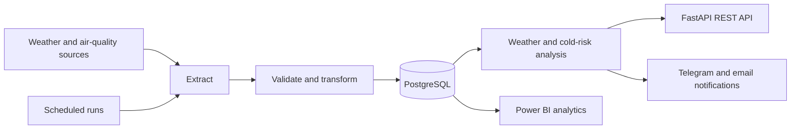

# Dakar Weather Intelligence (DWI)

A weather data and decision-support platform focused on Dakar, Senegal. DWI is being developed as a practical engineering project that combines data ingestion, PostgreSQL storage, weather-risk analysis, a Python API, and Power BI analytics.

> **Project status: early development.** The repository currently contains the initial Python and PostgreSQL setup. The ETL pipeline, alert engine, API endpoints, notifications, and Power BI model are planned work and are not yet implemented.

## Project goals

DWI aims to:

- Collect and retain weather and air-quality data relevant to Dakar.
- Build a traceable ETL pipeline with validation, normalization, and quality checks.
- Analyze weather conditions, including cold nights, perceived temperature, wind, rainfall, heat, and air quality.
- Provide configurable alerts and practical recommendations for activities.
- Expose data through a Python REST API and analytics-ready PostgreSQL views.
- Support historical analysis and decision-making in Power BI.

The initial data-source design considers Open-Meteo weather and air-quality APIs, with ANACIM as a local reference and potential source as the integration evolves.

## Planned architecture



This is the **target architecture**; most of these components are still on the roadmap.

## Technology

| Area | Planned / current technology |
| --- | --- |
| Language | Python 3.12+ |
| API and validation | FastAPI, Pydantic |
| Database | PostgreSQL 17 |
| Database access and migrations | SQLAlchemy 2, Alembic |
| Data processing | Pandas, NumPy |
| HTTP ingestion | HTTPX |
| Scheduling | APScheduler |
| Data quality | Pandera |
| BI | Power BI, SQL, DAX |
| Local database environment | Docker Compose |

## Current implementation

The repository currently provides:

- A modular Python package scaffold.
- Environment-based application and database configuration.
- A SQLAlchemy engine and session factory.
- A Docker Compose service for PostgreSQL 17.
- A script to check the PostgreSQL connection.

The following are **not yet implemented**: production data collectors, ETL transformations and persistence, database models or migrations, weather alert rules, FastAPI routes, notification delivery, and the Power BI star schema and report.

## Getting started

### Prerequisites

- Python 3.12 or newer
- Docker Desktop with Docker Compose
- Git

### 1. Clone the repository

```bash
git clone https://github.com/FullStackFlow-dev/Dakar-Weather-Intelligence_-DWI-.git
cd Dakar-Weather-Intelligence_-DWI-
```

### 2. Create a virtual environment and install dependencies

On Windows PowerShell:

```powershell
python -m venv .venv
.\.venv\Scripts\Activate.ps1
python -m pip install --upgrade pip
python -m pip install -r requirements.txt
```

On macOS or Linux:

```bash
python3 -m venv .venv
source .venv/bin/activate
python -m pip install --upgrade pip
python -m pip install -r requirements.txt
```

### 3. Configure the environment

Copy the example file and set a local database password:

```powershell
Copy-Item .env.example .env
```

Edit `.env` to match your local setup. Keep real credentials in `.env` only; never commit that file. The committed `.env.example` contains placeholders for local configuration.

### 4. Start PostgreSQL

```bash
docker compose up -d
docker compose ps
```

Wait for the `postgres` service to report as healthy before checking the connection.

### 5. Check the database connection

```bash
python test_database.py
```

A successful run prints a confirmation and the PostgreSQL server version.

### Windows driver note

The current configuration uses `psycopg[binary]`. On one Windows development machine, Windows Application Control blocked the driver's native DLL, so the connection script failed while importing the driver—before it could test the database credentials or network connection. A pure-Python driver such as `pg8000` has been identified as a possible follow-up, but the repository has not yet been updated or verified with that driver. If you encounter this issue, treat the database connection step as unresolved rather than as a PostgreSQL server failure.

## Data and analytics direction

The planned operational model includes locations, weather and air-quality snapshots, alert rules, alerts, activities, notification deliveries, and ETL run history.

For Power BI, the intended analytical layer is a star schema with forecast and alert facts and shared date, location, indicator, and activity dimensions. Forecast collection time and forecast-valid time will be retained separately to support later forecast-quality analysis.

Cold Weather Intelligence is intended to consider perceived temperature and overnight lows alongside wind and humidity. Initial thresholds discussed during design are provisional and require calibration against local observations. They are not official health or safety thresholds.

## Roadmap

1. Resolve and verify the PostgreSQL driver and connection on the development environment.
2. Define the PostgreSQL models and versioned schema migrations.
3. Implement weather and air-quality ingestion, validation, transformation, and loading.
4. Add configurable weather and cold-weather analysis rules.
5. Build the FastAPI endpoints and notification delivery flow.
6. Create analytics views, the Power BI star schema, and report measures.
7. Add operational monitoring, repeatable integration checks, and deployment documentation.

Work is being completed incrementally. Each stage should be verified before the next one begins.

## Security

- Keep `.env`, database passwords, API keys, and notification credentials out of version control.
- Use `.env.example` only for non-secret configuration examples.
- Do not expose database port `5432` publicly when running the local Compose setup.
- Never remove the persistent Docker volume unless you intentionally want to delete its database data.

## License

No license has been added yet. Until a license is published, reuse and redistribution rights are not explicitly granted.

---

**Dakar Weather Intelligence (DWI)** — a data engineering and analytics project for weather awareness in Dakar.
